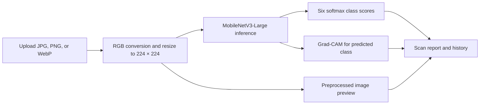

<div align="center">

# DermAI — Skin Lesion Analysis

**An AI-assisted research prototype for skin-lesion image classification and visual model explainability.**

Built with **PyTorch · MobileNetV3-Large · FastAPI · React · Grad-CAM**

[Features](#features) · [Model](#model--classification-classes) · [EDA & training](#dataset-eda--training-workflow) · [Visualizations](#visualizations) · [Evaluation](#evaluate-the-checkpoint) · [Getting started](#getting-started) · [Disclaimer](#medical--research-use-disclaimer)

</div>

---

## Overview

DermAI provides a web workspace for uploading a skin-lesion image and reviewing a six-class model prediction. Reports include prediction scores, the preprocessed image, and a Grad-CAM heatmap. Users can also review scan history, dashboard summaries, and download PDF reports.

> **Important:** DermAI is a research and educational prototype, not a medical device or diagnostic service. Its predictions and visualizations must not be used to diagnose, rule out, or treat a skin condition.

## Features

- Upload JPG, PNG, or WebP images (up to 10 MB).
- MobileNetV3-Large inference across six lesion-image classes.
- Prediction scores, preprocessed-image view, and per-scan Grad-CAM visualization.
- Account registration/sign-in, scan history, dashboard summaries, and PDF reports.
- FastAPI backend with interactive API documentation.
- Optional evaluation script to generate an actual held-out-set confusion matrix and class-count graphic.

## Model & classification classes

The inference service loads `backend/ml_models/best_model.pth`, converts images to RGB, resizes them to **224 × 224**, and applies ImageNet channel normalization.

| Code | Class |
|---|---|
| `MEL` | Melanoma |
| `NEV` | Melanocytic nevus |
| `BCC` | Basal cell carcinoma |
| `ACK` | Actinic keratosis |
| `SEK` | Seborrheic keratosis |
| `SCC` | Squamous cell carcinoma |

Displayed scores are softmax outputs, not calibrated clinical probabilities. Prototype risk labels are informational mappings, not clinical assessments.

## Dataset EDA & training workflow

The project identifies **PAD-UFES-20** as its dataset. Its publication describes smartphone clinical photographs and associated patient and lesion information. The project interface cites published totals of **2,298 images, 1,641 lesions, and 1,373 patients**; these are dataset-level counts, not the training split for this checkpoint.

Recommended EDA for reproducing or extending the project:

1. Verify image paths, labels, missing metadata, corrupt files, and duplicates.
2. Count images per class and inspect imbalance before selecting a split or sampling strategy.
3. Review image dimensions, color distributions, and representative samples by class.
4. Review relevant metadata and use patient-level train/validation/test separation where possible to reduce leakage.
5. Document splits, preprocessing, augmentation, and evaluation methodology for reproducibility.

The repository contains inference code and a checkpoint, but no training scripts/notebooks, EDA artifacts, split manifests, or evaluation metrics. Exact training settings and performance therefore cannot be verified or claimed here. The steps above are a recommended workflow, not a description of confirmed training runs.

Dataset reference: [PAD-UFES-20 publication](https://doi.org/10.1038/s41597-020-00608-w).

## Visualizations

### Application inference flow



The dashboard visualizes the user's scan history and class/risk distributions. The report page shows the original image, preprocessed image, prediction scores, and the Grad-CAM overlay generated at runtime. No sample Grad-CAM image is committed to the repository.

### Grad-CAM

The backend generates Grad-CAM for the predicted class from MobileNetV3-Large's final feature layer, then blends the resized heatmap with the input. This is a coarse activation visualization—not a lesion boundary, medical rationale, or evidence that a highlighted region is clinically meaningful.

### Confusion matrix and test-set class counts

Use the evaluation script below to generate the confusion matrix and class distribution from your own labeled, held-out images. No matrix or performance values are hard-coded into this README because the repository does not include test predictions or a documented test split.

## Evaluate the checkpoint

The optional `backend/evaluate_model.py` script evaluates the existing checkpoint against images arranged into class-code folders. The folder names are treated as ground-truth labels:

```text
heldout_images/
├── MEL/  # actual melanoma-labeled images
├── NEV/
├── BCC/
├── ACK/
├── SEK/
└── SCC/
```

Place only held-out evaluation images in this directory. From the repository root, run:

```bash
python backend/evaluate_model.py --data-dir path/to/heldout_images --output-dir evaluation_output
```

Optional arguments include `--batch-size 32`, `--device cpu`, or `--checkpoint path/to/best_model.pth`. By default, the script uses `backend/ml_models/best_model.pth` and automatically selects CUDA when available.

It writes:

- `confusion_matrix.png` — actual vs. predicted class counts, with row percentages.
- `class_distribution.png` — ground-truth class counts in the evaluation set (not the full dataset EDA).
- `metrics.json` — accuracy and per-class precision, recall, F1, and support.
- `predictions.csv` — image path, true class, and predicted class for auditability.

The confusion matrix uses **rows for true labels** and **columns for predicted labels**. Report the evaluation split and per-class support with any metrics. Patient-level separation should be considered to reduce leakage. Test results are not clinical validation.

## Technology stack

- **Frontend:** React 18, Vite, React Router, Axios, Recharts, and jsPDF
- **Backend:** Python, FastAPI, Uvicorn, SQLAlchemy, SQLite
- **ML & imaging:** PyTorch, TorchVision, Pillow, NumPy, and Matplotlib

## Getting started

### Prerequisites

- Python **3.10 or newer**
- Node.js and npm
- Model checkpoint at `backend/ml_models/best_model.pth` (included in this repository)

### Run the backend

In Windows PowerShell, from the repository root:

```powershell
cd backend
python ensure_backend.py
```

The helper creates the backend virtual environment and installs requirements on first use, then starts the API. Alternatively, set it up manually:

```powershell
cd backend
py -m venv .venv
.\.venv\Scripts\Activate.ps1
python -m pip install -r requirements.txt
python -m uvicorn app.main:app --reload
```

API: <http://127.0.0.1:8000> · Interactive docs: <http://127.0.0.1:8000/docs>

### Run the frontend

In a second terminal:

```powershell
cd frontend
npm install
npm run dev
```

Open the Vite URL printed in the terminal (normally <http://localhost:5173>). The frontend uses `http://127.0.0.1:8000` by default; set `VITE_API_URL` before starting Vite to use a different backend URL. Keep both services running. VS Code's **Run DermAI app** task can start both services.

## API overview

| Method | Endpoint | Purpose |
|---|---|---|
| `POST` | `/auth/register` | Register an account |
| `POST` | `/auth/login` | Sign in |
| `POST` | `/predict` | Upload an image and create a prediction report |
| `GET` | `/history` | List saved scans (optionally filtered by `user_id`) |
| `GET` | `/history/{scan_id}` | Retrieve a saved scan report |

See `/docs` while the backend is running for request and response schemas.

## Repository structure

```text
.
├── backend/
│   ├── app/                 # API, inference, and persistence
│   ├── ml_models/           # Trained checkpoint
│   ├── evaluate_model.py    # Held-out evaluation and plots
│   └── requirements.txt
├── frontend/src/            # React application and report UI
└── README.md
```

## Medical & research-use disclaimer

DermAI is experimental software and has not been established as safe or effective for clinical use. Outputs may be incorrect or biased, and performance on uploaded images may differ from performance on development data. A low-risk label or benign prediction does not rule out disease. Consult a qualified healthcare professional about health concerns; do not delay care based on this application.

## Acknowledgements

- PAD-UFES-20 dataset authors: [original publication](https://doi.org/10.1038/s41597-020-00608-w).
- PyTorch and TorchVision teams for the deep learning framework and model implementations.
