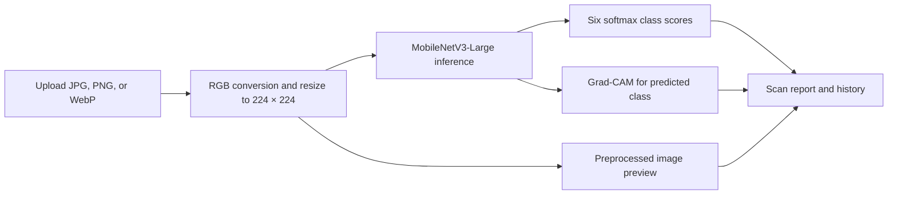

<div align="center">

# DermAI — Skin Lesion Analysis

**An AI-assisted research prototype for exploring skin-lesion image classification and visual model explainability.**

Built with **PyTorch · MobileNetV3-Large · FastAPI · React · Grad-CAM**

[Features](#features) · [Model & classes](#model--classification-classes) · [EDA & training](#dataset-eda--training-workflow) · [Visualizations](#visualizations) · [Getting started](#getting-started) · [API](#api-overview) · [Limitations](#medical--research-use-disclaimer)

</div>

---

## Overview

DermAI provides a web workspace for uploading a skin-lesion image and reviewing a six-class model prediction. Each report brings together the predicted class, the model's softmax scores, a resized input image, and a Grad-CAM heatmap. Registered users can also view scan history, explore dashboard summaries, and download a PDF report.

> **Important:** DermAI is a research and educational prototype, not a medical device or diagnostic service. Its predictions and visualizations must not be used to diagnose, rule out, or treat a skin condition.

## Features

- Image upload for **JPG, PNG, and WebP** files (up to 10 MB).
- Six-class skin-lesion image classification using a **MobileNetV3-Large** model.
- Prediction report with class scores and image preprocessing view.
- **Grad-CAM** overlay to inspect image regions that influenced a prediction.
- Account registration and sign-in, scan history, dashboard summaries, and PDF report downloads.
- FastAPI backend with interactive API documentation.

## Model & classification classes

The inference service loads the trained checkpoint at `backend/ml_models/best_model.pth`. It converts images to RGB, resizes them to **224 × 224**, and applies ImageNet channel normalization before inference. The six output labels are:

| Code | Class |
|---|---|
| `MEL` | Melanoma |
| `NEV` | Melanocytic nevus |
| `BCC` | Basal cell carcinoma |
| `ACK` | Actinic keratosis |
| `SEK` | Seborrheic keratosis |
| `SCC` | Squamous cell carcinoma |

The displayed scores are the model's softmax outputs; they are **not calibrated clinical probabilities**. The app also maps predicted classes to prototype risk labels, which are informational mappings rather than clinical assessments.

## Dataset EDA & training workflow

The project identifies **PAD-UFES-20** as its dataset. The dataset is described in the original publication as containing smartphone clinical photographs and associated patient and lesion information. The project interface cites published totals of **2,298 images, 1,641 lesions, and 1,373 patients**; these are dataset-level counts, not a statement of the training split used for this checkpoint.

A useful exploratory data analysis (EDA) process for reproducing or extending this work is:

1. Load the dataset's image/metadata annotations and verify file paths, labels, and missing values.
2. Count examples by class and inspect class imbalance before choosing a split or sampling strategy.
3. Review image dimensions, color distributions, and representative samples for each class; check for corrupt or duplicate files.
4. Examine relevant metadata distributions and consider patient-level separation between train, validation, and test sets to reduce leakage between images from the same patient.
5. Record the split, preprocessing, augmentation, and evaluation methodology so results can be reproduced.

The deployed inference code shows a **MobileNetV3-Large** architecture with a six-output classification layer and uses the checkpoint above. However, the repository does not currently include training scripts or notebooks, EDA artifacts, split manifests, or evaluation metrics. Therefore, exact training hyperparameters, augmentation strategy, split composition, and model performance cannot be verified from this repository and are not claimed here. The checklist above is a recommended workflow—not a description of confirmed training runs.

Dataset reference: [PAD-UFES-20: a skin lesion dataset composed of patient data and clinical images collected from smartphones](https://doi.org/10.1038/s41597-020-00608-w).

## Visualizations

### Application analysis flow



The app's dashboard includes scan-history summaries and class/risk distribution graphics. For an individual analysis, open its result page to see the uploaded image, preprocessed image, prediction scores, and the Grad-CAM overlay generated for that scan. The repository does not currently include a static sample Grad-CAM image, so the visualization is produced at runtime rather than embedded here.

### Confusion matrix

A confusion matrix is a useful evaluation graphic, but it must be calculated from ground-truth labels and model predictions on a held-out test set. This repository does not include evaluation predictions or a test split, so no numerical matrix or accuracy is presented here. Once you have the true and predicted labels from your evaluation, this snippet generates a labeled matrix (rows are actual classes; columns are predicted classes):

```python
# Optional evaluation dependency: python -m pip install scikit-learn
import matplotlib.pyplot as plt
from sklearn.metrics import ConfusionMatrixDisplay, confusion_matrix

class_names = ["MEL", "NEV", "BCC", "ACK", "SEK", "SCC"]

# Replace these with labels collected from the held-out test set.
y_true = [...]  # integer class indices, in class_names order
y_pred = [...]  # integer class indices, in class_names order

matrix = confusion_matrix(y_true, y_pred, labels=range(len(class_names)))
display = ConfusionMatrixDisplay(confusion_matrix=matrix, display_labels=class_names)
display.plot(cmap="Blues", values_format="d", xticks_rotation=45)
plt.title("DermAI — held-out test confusion matrix")
plt.tight_layout()
plt.savefig("confusion_matrix.png", dpi=200, bbox_inches="tight")
plt.show()
```

Only publish a confusion matrix after evaluating on a documented held-out set. Include the split methodology and per-class support alongside it; consider patient-level splits to limit leakage. Do not treat test-set results as clinical validation.

## Grad-CAM explainability

For each prediction, the backend generates a Grad-CAM map for the predicted class using the final feature layer of MobileNetV3-Large. The heatmap is resized and blended with the input image to create the overlay shown in the report.

Grad-CAM is a coarse visualization of model activation. It is **not** a lesion segmentation, a reliable explanation of medical reasoning, or evidence that the highlighted region is clinically meaningful. Use it only as an interpretability aid when exploring model behavior.

## Technology stack

- **Frontend:** React 18, Vite, React Router, Axios, Recharts, and jsPDF
- **Backend:** Python, FastAPI, Uvicorn, SQLAlchemy, and SQLite
- **Machine learning & imaging:** PyTorch, TorchVision, Pillow, NumPy, and Matplotlib

## Getting started

### Prerequisites

- Python **3.10 or newer**
- Node.js and npm
- The model checkpoint at `backend/ml_models/best_model.pth` (included in this repository)

### Run the backend

From the repository root, in Windows PowerShell:

```powershell
cd backend
python ensure_backend.py
```

This helper creates the backend virtual environment and installs the Python requirements on first use, then starts the API. Alternatively, start it manually:

```powershell
cd backend
py -m venv .venv
.\.venv\Scripts\Activate.ps1
python -m pip install -r requirements.txt
python -m uvicorn app.main:app --reload
```

The API is available at <http://127.0.0.1:8000>; interactive Swagger documentation is at <http://127.0.0.1:8000/docs>.

### Run the frontend

In a second terminal:

```powershell
cd frontend
npm install
npm run dev
```

Open the Vite URL printed in the terminal (normally <http://localhost:5173>). The frontend uses `http://127.0.0.1:8000` by default. To point it at another API URL, set `VITE_API_URL` in the frontend environment before starting Vite, for example:

```env
VITE_API_URL=http://127.0.0.1:8000
```

Keep both backend and frontend processes running while using the app. In VS Code, the repository's **Run DermAI app** task can start both services; if prompted, allow automatic tasks.

## API overview

| Method | Endpoint | Purpose |
|---|---|---|
| `POST` | `/auth/register` | Register an account |
| `POST` | `/auth/login` | Sign in |
| `POST` | `/predict` | Upload an image and create a prediction report |
| `GET` | `/history` | List saved scans (optionally filtered by `user_id`) |
| `GET` | `/history/{scan_id}` | Retrieve a saved scan report |

See the interactive API documentation at `/docs` while the backend is running for request and response schemas.

## Repository structure

```text
.
├── backend/
│   ├── app/                 # FastAPI app, model inference, persistence
│   ├── ml_models/            # Trained model checkpoint
│   └── requirements.txt
├── frontend/
│   ├── src/                  # React application and report UI
│   └── package.json
└── README.md
```

## Medical & research-use disclaimer

DermAI is an experimental software project. It has not been established as safe or effective for clinical use. Model outputs may be incorrect or biased, and performance on an uploaded image may differ from performance on the data used to develop the model. A low-risk label or benign prediction does not rule out disease. Consult a qualified healthcare professional for any health concern; do not delay care based on this application.

## Acknowledgements

- PAD-UFES-20 dataset authors and contributors: [original dataset publication](https://doi.org/10.1038/s41597-020-00608-w).
- The PyTorch and TorchVision teams for the deep learning framework and model implementations.
